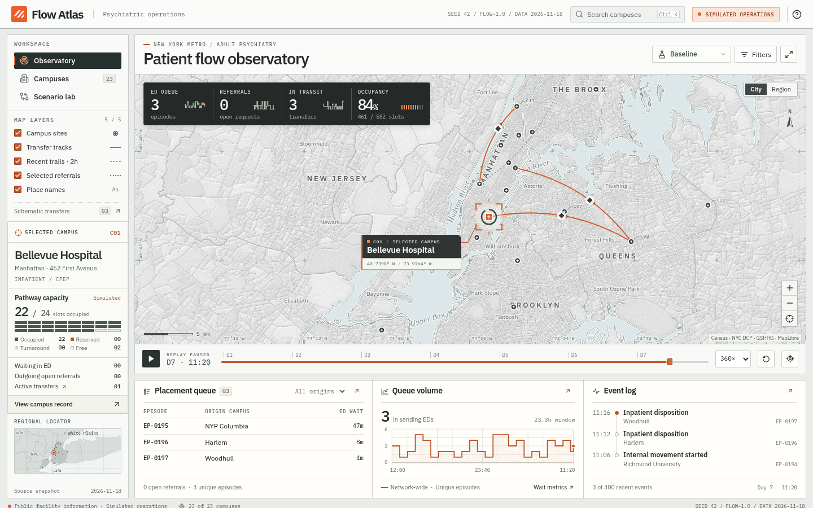

# Flow Atlas

Flow Atlas is a psychiatric patient-flow observatory for New York City and Westchester. Explore 23 documented campuses, inspect their public service records, and replay seven synthetic days of adult inpatient placement. Every queue entry, referral, capacity value and transfer comes from the selected simulation.



## Run locally

Use Node.js 22.12 or later and npm. Development and verification used Node.js 24.22.1. From the repository root:

```sh
npm ci
npm run dev
```

On the managed cloud machine the default npm cache is read-only. Run `npm ci --cache /tmp/flow-atlas-npm` for the install step there.

Open the local address printed by Vite. The dashboard opens paused on a reproducible transfer. Geography, fonts, source records and simulation code are bundled. Installing dependencies requires package-registry access. Running the installed app only requires access to the local server. Source citations open the original publisher's website.

## Production and verification

```sh
npm run lint
npm test
npm run build
npm run preview -- --host 127.0.0.1 --port 4173 --strictPort
```

The build runs the strict TypeScript check. To run it separately, use `npm run typecheck`. In a second terminal with the preview running:

```sh
python3 scripts/import-data.py --check
npm run test:browser -- --url http://127.0.0.1:4173
node tests/browser_capture.mjs --url http://127.0.0.1:4173 --out docs/screenshots --prefix observatory --comparison
```

Browser checks use a system Chromium on Linux when available. Otherwise install the browser once with `npx playwright install chromium` or set `CHROMIUM_BIN` to a compatible executable. Python 3 supports the source-table import and integrity check. Optional map asset regeneration uses the dependencies in the [cartography notes](src/cartography/README.md). Open the app with `?map=svg` to select the local flat map explicitly. Loss of WebGL also activates the flat renderer.

## Reproduce the demonstration

1. Start **Baseline**, seed 42. The opening sample is **Day 7, 11:20**, with three episodes in transit. Select the moving symbol for **EP-0190**, or open **Schematic transfers** in the map layers panel. Its destination slot remains reserved as it travels from Bellevue to Queens Hospital.
2. Open **View campus record** for Bellevue. Expand a program or provider service and inspect the published scope, registry key, dates and source links. The synthetic 24-slot pool appears separately in the inspector.
3. Open the **Placement queue**. Inspect an episode's physical state, stage times and referral requests. The table counts each waiting episode once. **Wait metrics** shows completed intervals and ongoing counts. The event log can be filtered to resource alerts.
4. Press **Play** at 360×, pause, then use the slider to seek backward. The target button restores the sample transfer. The reset button seeks to **Day 1, 00:00**. At that time, select **Capacity −8** and inspect Bellevue. Its target falls to 16, with 20 slots still active and four closures pending.
5. Return to Baseline. Use **Region** to include White Plains, or find a campus in **Campuses**. Filters narrow map and list results. The map’s telemetry strip continues to describe the whole simulated network.
6. Open **Scenario lab**, select **Demand +30%**, and compare **Matched base** with **All arrivals**. Both branches have 211 matched arrivals. The surge has 271 total arrivals. Export JSON to retain both cohorts, observation window, seed, model version, source snapshot, and metric definitions.

See the [documentation index](docs/README.md), [build status](docs/BUILD_STATUS.md), [browser results](docs/VERIFICATION.md), and [project skill guide](.agents/skills/README.md).
